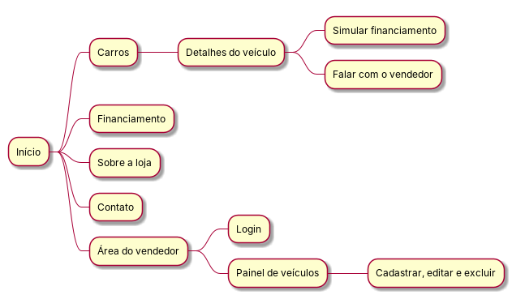
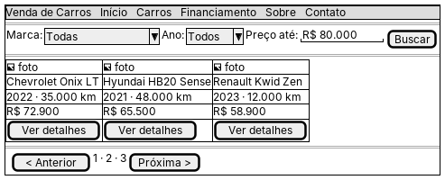
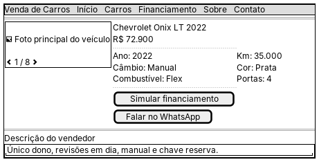
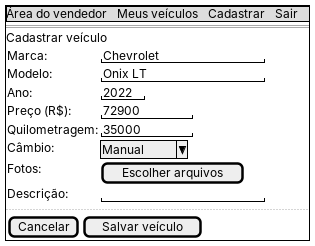
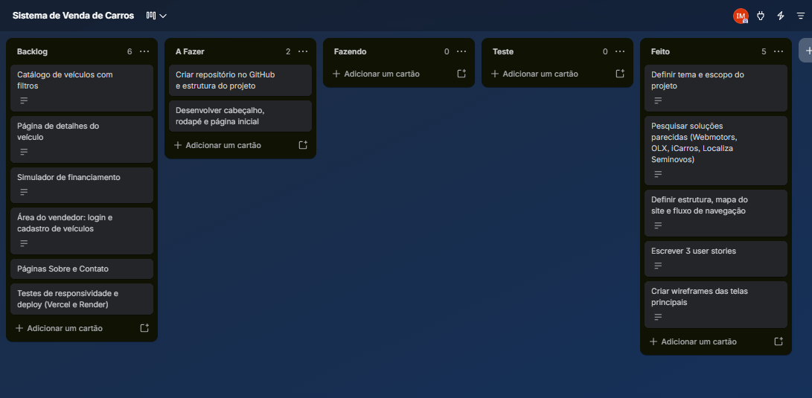

# Atividade 02 — Escopo, Prototipação e UX

**Disciplina:** Programação Web — Prof. Me. Deivison S. Takatu
**Integrantes:** Isabela Oliveira, Maria Luiza Oliveira, Veronica das Dores e Rafael Rachid

## 1. Tema e escopo

**Tema:** Sistema de Venda de Carros

Site de uma revenda de carros seminovos. O cliente consulta o estoque, filtra por marca, ano e preço, vê os detalhes de cada carro, simula o financiamento e fala com o vendedor pelo WhatsApp. O vendedor tem uma área com login para cadastrar, editar e excluir os veículos anunciados. O site será responsivo, para funcionar no celular e no computador.

**Tipo de aplicação:** plataforma (catálogo com área administrativa).

## 2. Pesquisa de soluções parecidas

| Site | Pontos fortes | Pontos fracos |
|---|---|---|
| **Webmotors** | Muitos anúncios, filtros detalhados e simulação de financiamento integrada | Aceita vendedores pessoa física, o que exige mais cuidado do comprador; muita publicidade |
| **OLX (Autos)** | Grande volume de ofertas locais e anúncio simples | Classificado generalista; busca menos específica para carros e mais risco de golpe |
| **iCarros** | Busca por marca, modelo e versão, com financiamento integrado | Busca tradicional, sem diferenciais de experiência |
| **Localiza Seminovos** | Estoque próprio e revisado, fotos reais, simulação 100% online e uso do carro na troca | Mostra só os carros da própria empresa |

**O que vamos aproveitar:** filtros simples, página de detalhes com fotos e ficha técnica, simulação de financiamento e contato direto com a loja.

## 3. Estrutura da aplicação

### Principais componentes
- **Cabeçalho** com o menu (Início, Carros, Financiamento, Sobre e Contato)
- **Filtro de busca** por marca, ano e preço
- **Cartão de veículo** com foto, modelo, ano, quilometragem e preço
- **Página de detalhes** com galeria de fotos, ficha técnica e botões de ação
- **Simulador de financiamento** com entrada e número de parcelas
- **Área do vendedor** com login e formulário de cadastro de veículos
- **Rodapé** com endereço, telefone e redes sociais

### Mapa do site e fluxo de navegação

**Fluxo do cliente:** Início → Carros → filtra a busca → Detalhes do veículo → Simular financiamento ou Falar no WhatsApp.
**Fluxo do vendedor:** Área do vendedor → Login → Painel de veículos → Cadastrar, editar ou excluir.

### Arquitetura
| Camada | Tecnologia |
|---|---|
| Front-end | React |
| Back-end | Node.js com Express (API REST) |
| Banco de dados | Banco relacional para veículos e usuários |
| Hospedagem | Vercel (front-end) e Render (API) |
| Versionamento | Git e GitHub |

## 4. User stories

1. **Como** cliente, **eu quero** filtrar os carros por marca, ano e preço **para** encontrar rápido um carro que caiba no meu orçamento.
2. **Como** cliente, **eu quero** simular o financiamento na página do carro **para** saber o valor das parcelas antes de falar com a loja.
3. **Como** vendedor, **eu quero** cadastrar um carro com fotos, preço e descrição **para** que ele apareça no site sem precisar de um programador.

## 5. Wireframes (baixa fidelidade)

Feitos em PlantUML (Salt). O código de cada tela está na pasta [`wireframes`](wireframes).

**Catálogo de veículos**

**Detalhes do veículo**

**Área do vendedor: cadastro de veículo**

## 6. Kanban no Trello

Quadro: [Sistema de Venda de Carros](https://trello.com/b/tJQEytrj/sistema-de-venda-de-carros)

O quadro tem as listas **Backlog**, **A Fazer**, **Fazendo**, **Teste** e **Feito**. As etapas desta atividade (tema, pesquisa, estrutura, user stories e wireframes) estão em **Feito**; os próximos passos estão em **A Fazer** e as funcionalidades do sistema estão no **Backlog**.

## Referências

GONÇALVES, Rodrigo Franco et al. Uma proposta de processo de produção de aplicações Web. **Production**, v. 15, p. 376-389, 2005.

LUCASSEN, Garm et al. The use and effectiveness of user stories in practice. In: REQUIREMENTS ENGINEERING: FOUNDATION FOR SOFTWARE QUALITY, 22., 2016, Gothenburg. **Proceedings** [...]. Springer, 2016. p. 205-222.
