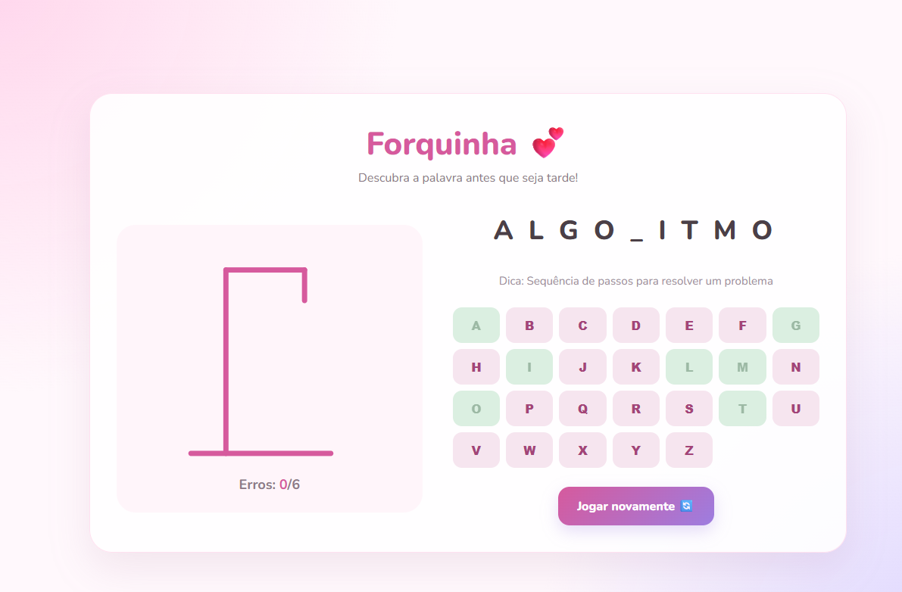
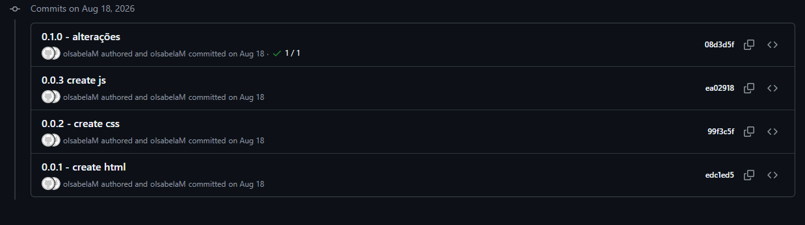
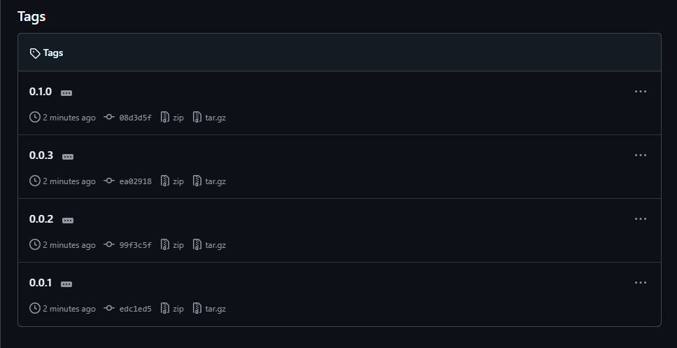
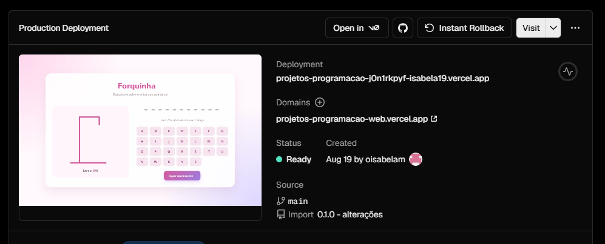
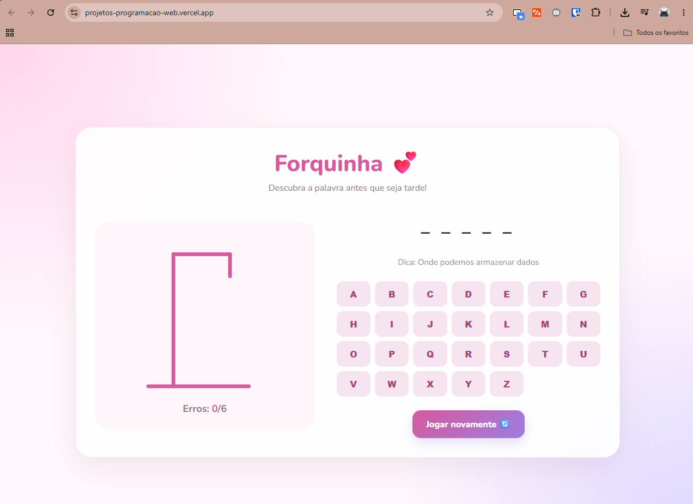

# Atividade 03 — Versionamento e Deploy

**Disciplina:** Programação Web — Prof. Me. Deivison S. Takatu
**Integrantes:** [preencher]

## Links

| Item | Link |
|---|---|
| Repositório | https://github.com/oIsabelaM/projetos_ProgramacaoWeb |
| Site na Vercel | https://projetos-programacao-web.vercel.app/ |

## 1. Projeto

**Forquinha 💕** é um jogo da forca feito com HTML, CSS e JavaScript puro. O jogador escolhe as letras num teclado na tela, recebe uma dica da palavra e tem 6 chances antes de a forca se completar.



## 2. Escolhas de design

- **Paleta em tons de rosa e lilás** (`#d65a9d`, `#fff5fa`, `#ddd6ff`), suave e acolhedora
- **Fonte Nunito** (Google Fonts), arredondada e fácil de ler
- **Cartão central** com bordas arredondadas e sombra leve, que concentra a atenção no jogo
- **Layout em duas colunas**: a forca à esquerda e a palavra com o teclado à direita
- **Forca desenhada em SVG**, revelada parte por parte a cada erro
- **Janela (modal)** de vitória ou derrota no fim da partida

## 3. Versionamento com Git

O projeto foi criado no VS Code e versionado com Git, com um commit para cada etapa:

| Versão | Commit | O que mudou |
|---|---|---|
| 0.0.1 | `create html` | Estrutura da página |
| 0.0.2 | `create css` | Estilização |
| 0.0.3 | `create js` | Lógica do jogo |
| 0.1.0 | `alterações` | Ajustes e personalização |

Comandos usados:

```bash
git init
git add .
git commit -m "0.0.1 - create html"
git remote add origin https://github.com/oIsabelaM/projetos_ProgramacaoWeb.git
git push -u origin main
```

Cada versão foi marcada com uma **tag anotada**, seguindo o Versionamento Semântico (MAJOR.MINOR.PATCH):

```bash
git tag -a 0.1.0 -m "0.1.0 - Personalização do jogo"
git push origin --tags
```




## 4. Deploy na Vercel

1. Login na Vercel com a conta do GitHub.
2. **Add New → Project** e importação do repositório `projetos_ProgramacaoWeb`.
3. Sem configurações extras, por ser um site estático, e clique em **Deploy**.
4. A cada `git push` na `main`, a Vercel publica a nova versão automaticamente.



