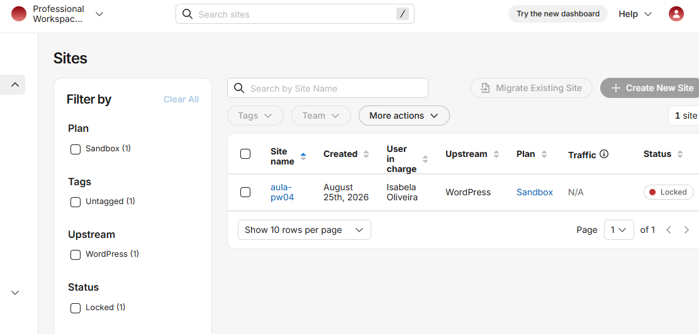
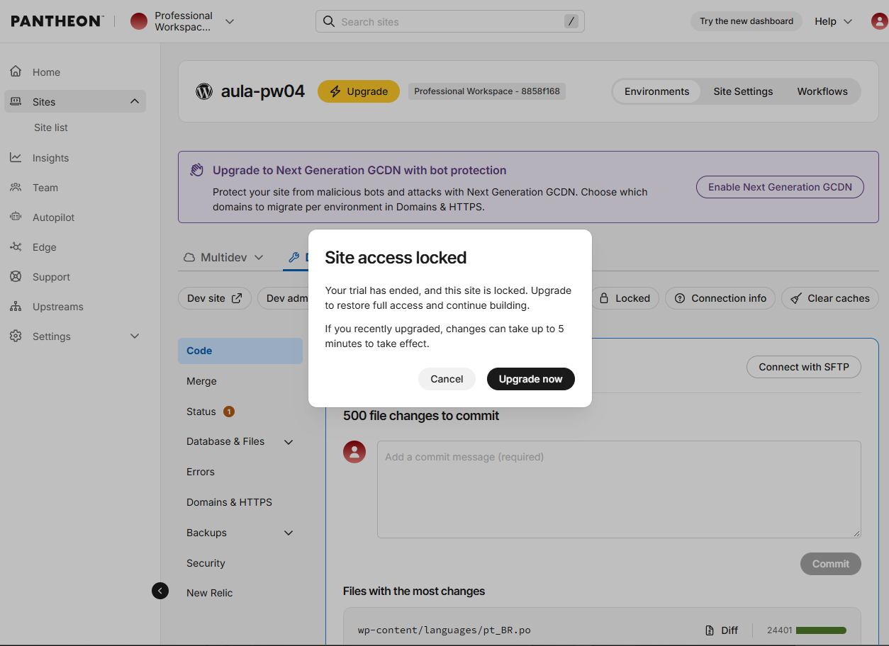

# Atividade 04 — Servidores, Hospedagem e CMS

**Disciplina:** Programação Web — Prof. Me. Deivison S. Takatu

## Links

| Item | Link |
|---|---|
| Hospedagem | Pantheon (plano Sandbox) |
| Site | `aula-pw04` — indisponível: bloqueado pela Pantheon após o fim do período de teste gratuito |

## 1. O que foi pedido

Criar conta em uma hospedagem, instalar um CMS, personalizar com temas e plugins e editar a página inicial.

## 2. O que foi feito

1. **Conta na Pantheon**, a hospedagem sugerida na aula, no plano gratuito **Sandbox**.
2. **Criação do site `aula-pw04`** com o CMS **WordPress**, em 25 de agosto de 2026.
3. **Instalação do WordPress em português do Brasil**, no ambiente de desenvolvimento (Dev).
4. **Personalização** com tema, plugins e edição da página inicial pelo painel do WordPress.

## 3. Situação atual do site

Em julho de 2026, a Pantheon trocou o plano gratuito por um **teste de 30 dias**. Quando o teste acabou, o site foi **bloqueado** (status *Locked*). Os arquivos continuam guardados na plataforma, mas só podem ser acessados com a assinatura de um plano pago.

O painel ainda mostra o trabalho feito: o site WordPress e os **500 arquivos alterados** no ambiente Dev, entre eles os arquivos de tradução para português do Brasil (`wp-content/languages/pt_BR.po`).

## 4. Lição aprendida

Hospedagens gratuitas podem mudar as regras ou expirar. Para entregas acadêmicas, vale tirar prints de cada etapa no momento em que ela é feita e preferir serviços sem prazo de validade.
