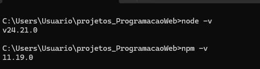
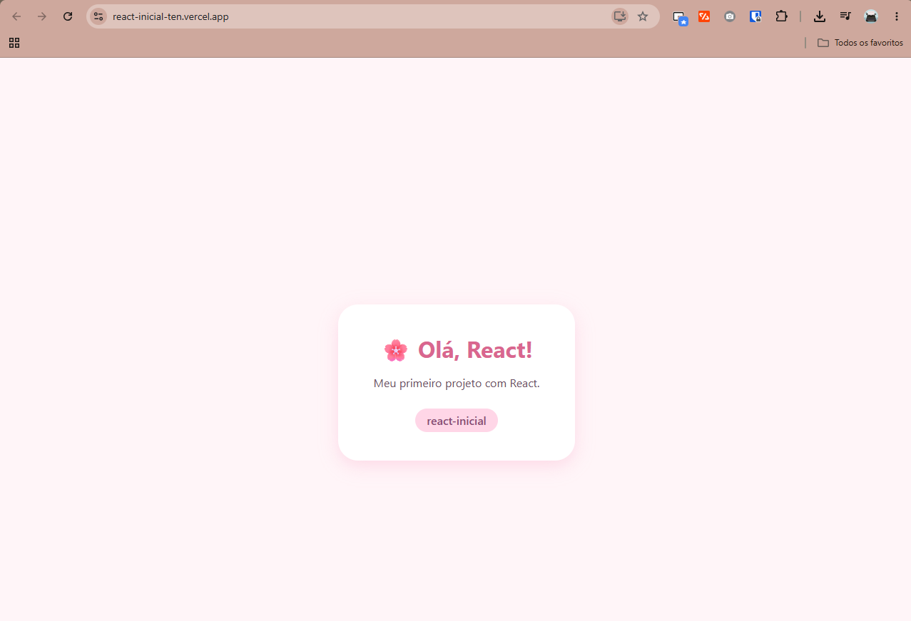
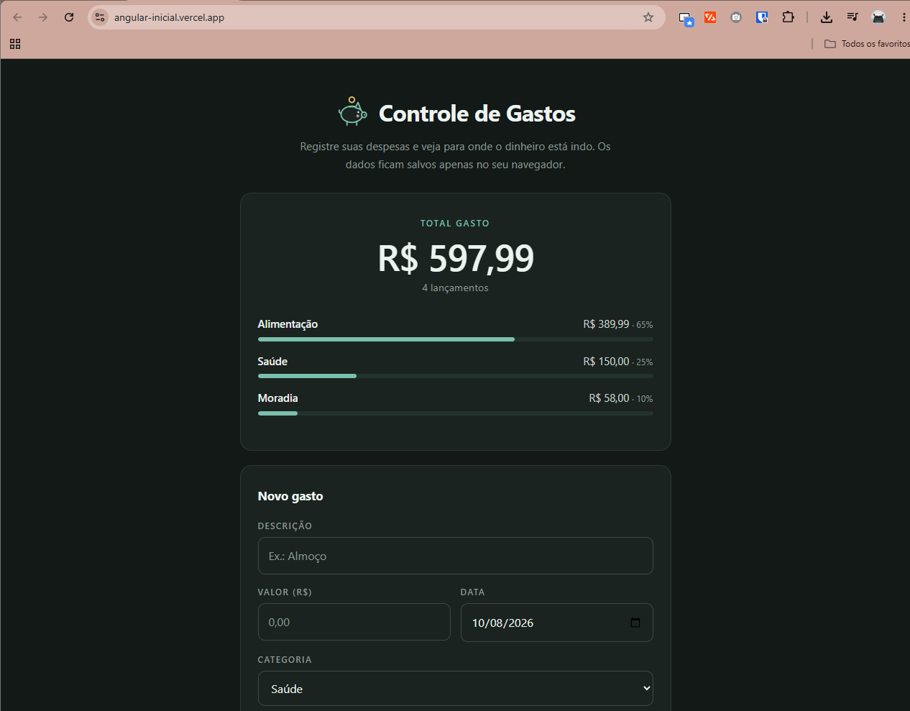
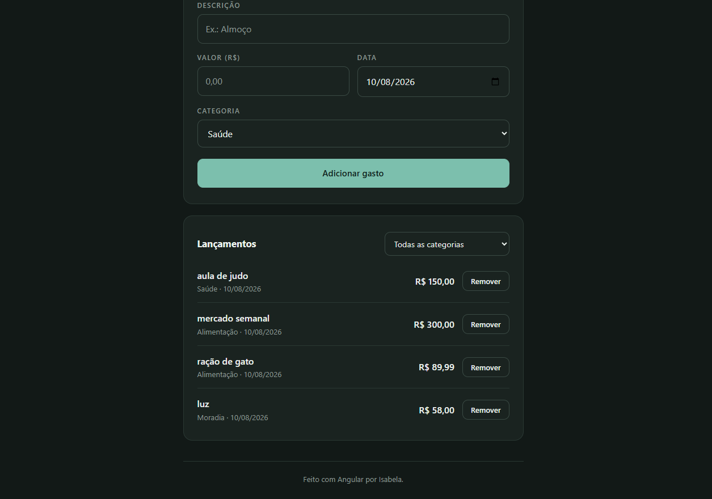
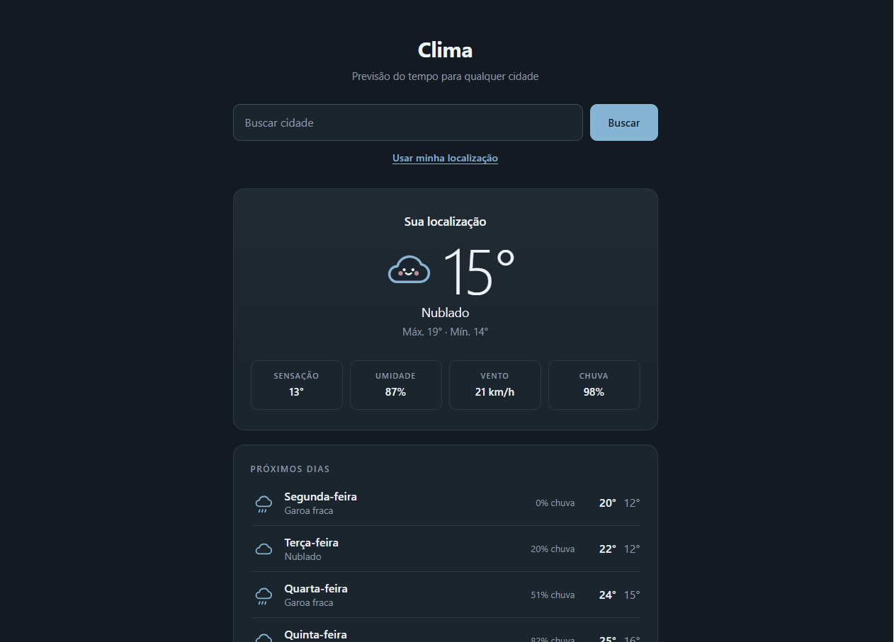
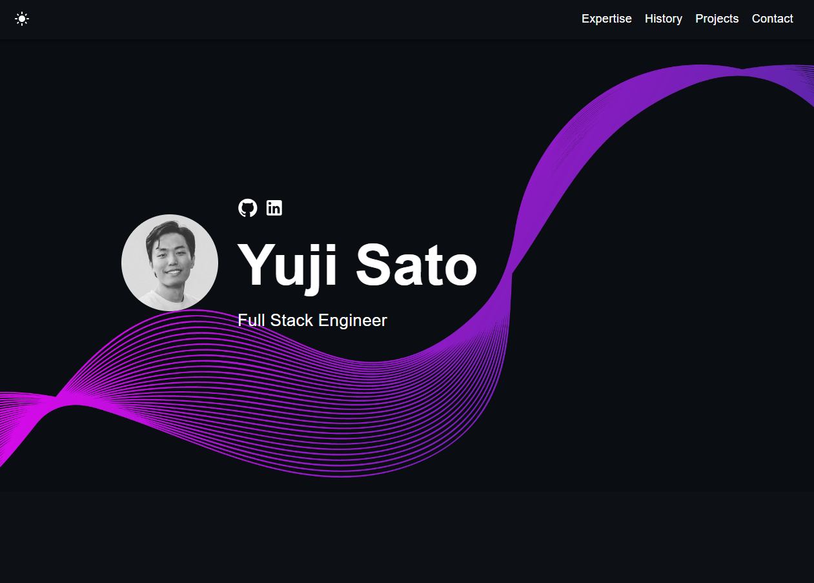
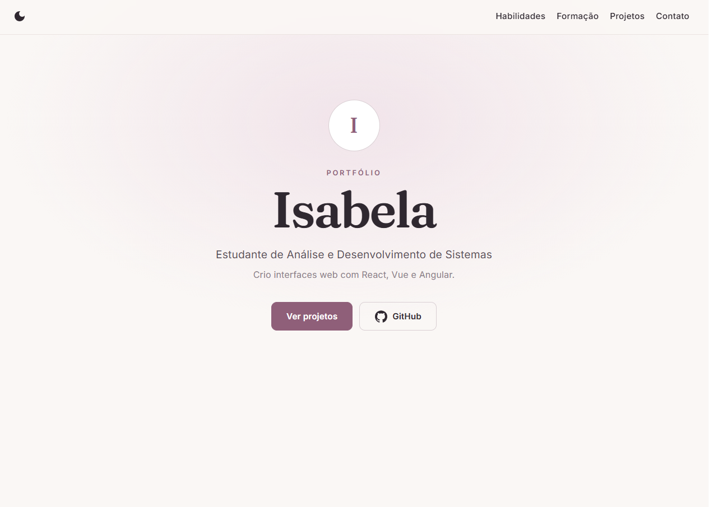
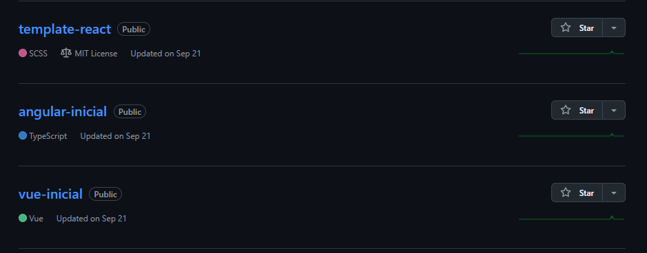
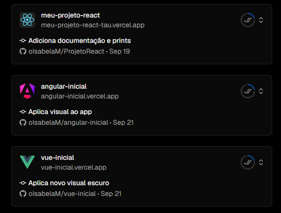

# Atividade 06 — Projetos Front-end com React, Angular, Vue e Template

**Disciplina:** Programação Web — Prof. Me. Deivison S. Takatu


## Links

| Projeto | Repositório | Site na Vercel |
|---|---|---|
| React | https://github.com/oIsabelaM/react-inicial | https://react-inicial-ten.vercel.app/ |
| Angular | https://github.com/oIsabelaM/angular-inicial | https://angular-inicial.vercel.app/ |
| Vue | https://github.com/oIsabelaM/vue-inicial | https://vue-inicial.vercel.app/ |
| Template | https://github.com/oIsabelaM/template-react | https://template-react-gamma.vercel.app/ |

## 1. Preparação do ambiente

Instalação do Node.js (que já inclui o NPM) e conferência das versões:

```bash
node -v
npm -v
```



## 2. Projeto React

**Criação:**

```bash
npx create-react-app react-inicial
cd react-inicial
npm start
```

**Alterações:** a tela padrão do React foi trocada por um cartão de boas-vindas ("🌸 Olá, React!"), com estilo próprio em `App.css`.

**Versões:** v0.1.0 e v0.2.0.



## 3. Projeto Angular — Controle de Gastos

**Criação:**

```bash
npm install -g @angular/cli
ng new angular-inicial
cd angular-inicial
ng serve
```

**Alterações:** o projeto virou um app para registrar despesas.
- Cadastro de gastos com validação dos campos
- Total geral e total por categoria, com barras de percentual
- Filtro por categoria e botão para remover
- Dados salvos no navegador (localStorage)
- Tema claro ou escuro, conforme o aparelho

**Versões:** v0.1.0 a v0.3.0.


   
## 4. Projeto Vue — Clima

**Criação:**

```bash
npm create vue@latest
cd vue-inicial
npm install
npm run dev
```

**Alterações:** o projeto virou um app de previsão do tempo que usa a API Open-Meteo.
- Busca de cidade pelo nome ou pela localização do aparelho
- Temperatura, sensação térmica, umidade e vento
- Previsão dos próximos cinco dias
- A cor do cartão muda conforme o tempo

**Versões:** v0.1.0 a v0.3.1.



## 5. Template importado — Portfólio

**Template escolhido:** [React Portfolio Template](https://yujisatojr.github.io/react-portfolio-template/), de Yuji Sato (React + TypeScript, licença MIT).

**Importação:** o template foi baixado, instalado com `npm install` e enviado para um quarto repositório no commit "Importa template original".

**Alterações:**
- Tema novo em tons pastel (`Pastel.scss`)
- Textos e seções adaptados para o portfólio da aluna
- Projetos da disciplina na seção de projetos, com prints e links: Projeto React, Relógio (Express), Clima (Vue) e Controle de Gastos (Angular)

**Versões:** v0.1.0, v0.2.1 e v1.0.0.




## 6. Versionamento

Os quatro projetos seguiram o mesmo fluxo, cada um no seu repositório:

```bash
git init
git add .
git commit -m "Altera tela inicial do projeto"
git remote add origin https://github.com/oIsabelaM/<repositorio>.git
git push -u origin main
git tag -a v0.1.0 -m "v0.1.0 - Projeto inicial"
git push origin v0.1.0
```



## 7. Deploy na Vercel

Para cada repositório: **Add New → Project**, importação do repositório e **Deploy**. A Vercel reconhece o framework (Create React App, Angular ou Vite) e configura a build sozinha.


