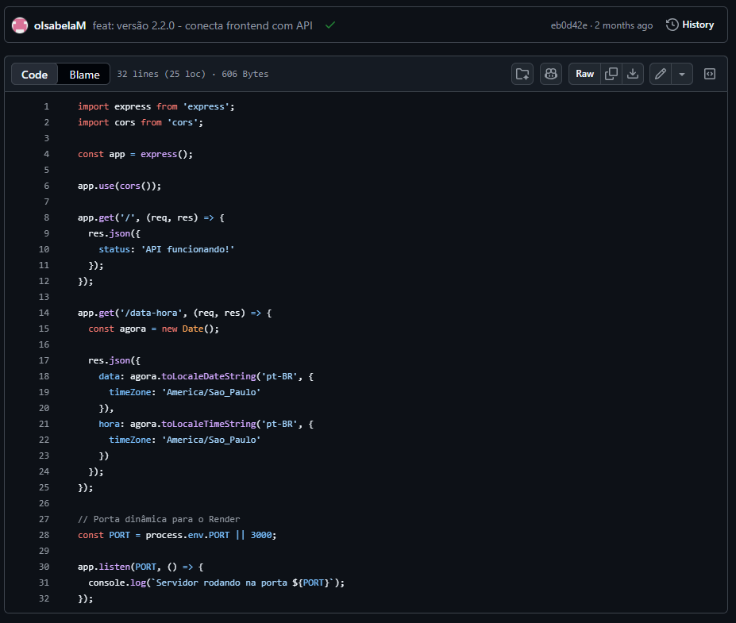
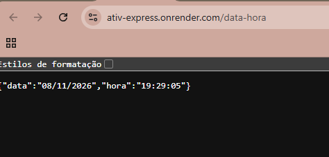
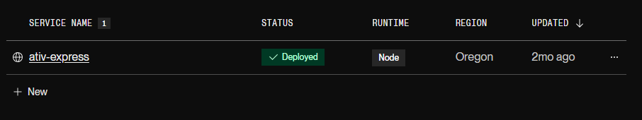
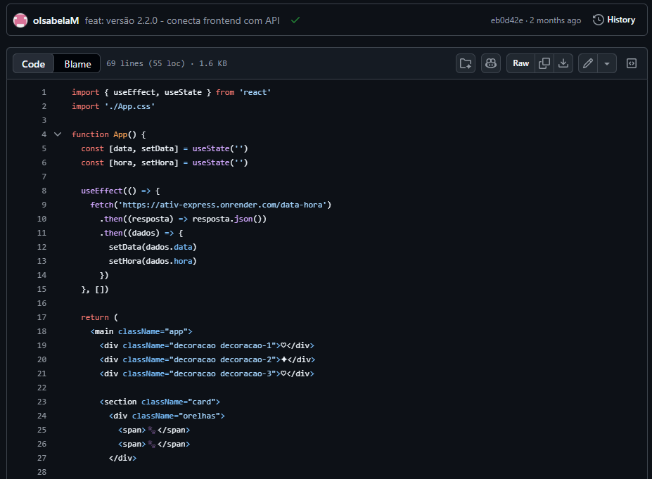
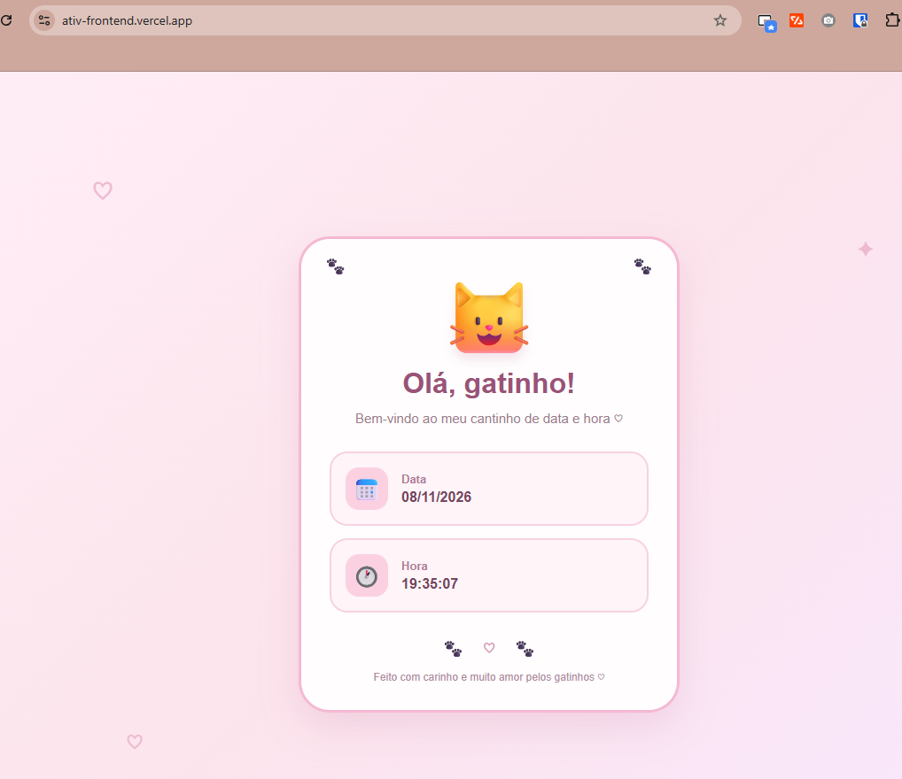
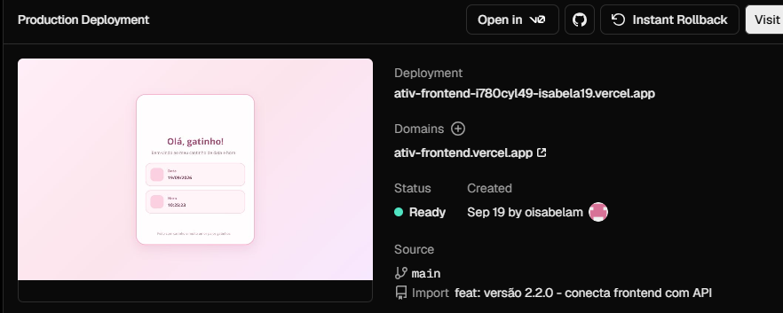

# Atividade 07 — API de Data e Hora com Express

**Disciplina:** Programação Web — Prof. Me. Deivison S. Takatu
**Integrantes:** [preencher]

## Links

| Item | Link |
|---|---|
| Repositório da API | https://github.com/oIsabelaM/ativ-express |
| Repositório do front-end | [preencher] |
| API no Render | https://ativ-express.onrender.com/data-hora |
| Front-end na Vercel | https://ativ-frontend.vercel.app/ |

## 1. API com Express

A API tem duas rotas:

| Método | Rota | Retorno |
|---|---|---|
| GET | `/` | `{ "status": "API funcionando!" }` |
| GET | `/data-hora` | `{ "data": "08/11/2026", "hora": "17:30:00" }` |

A data e a hora usam o fuso `America/Sao_Paulo`, para mostrar o horário de Brasília mesmo com o servidor do Render nos Estados Unidos. O `cors` libera o acesso do front-end, que fica em outro domínio.

```javascript
app.get('/data-hora', (req, res) => {
  const agora = new Date();
  res.json({
    data: agora.toLocaleDateString('pt-BR', { timeZone: 'America/Sao_Paulo' }),
    hora: agora.toLocaleTimeString('pt-BR', { timeZone: 'America/Sao_Paulo' })
  });
});

const PORT = process.env.PORT || 3000;
```

A porta vem de `process.env.PORT`, porque o Render define a porta do servidor.




## 2. Deploy no Render

1. **New → Web Service** e conexão com o repositório `ativ-express`.
2. Build Command: `npm install`
3. Start Command: `npm start` (roda `node api.js`)
4. Plano gratuito e clique em **Deploy**.



## 3. Front-end em React

Projeto criado com Vite (`npm create vite@latest`), num repositório separado da API. Ao abrir a página, ele busca a rota `/data-hora` e mostra o resultado num cartão:

```javascript
useEffect(() => {
  fetch('https://ativ-express.onrender.com/data-hora')
    .then(resposta => resposta.json())
    .then(dados => {
      setData(dados.data);
      setHora(dados.hora);
    });
}, []);
```

**Estilização:** tema de gatinho, com cartão central em tons de rosa, bordas arredondadas, sombra suave e detalhes decorativos (♡ ✦).




## 4. Deploy na Vercel

**Add New → Project**, importação do repositório do front-end e **Deploy**. A Vercel reconheceu o Vite e configurou a build sozinha.



## 5. Versionamento

| Tag | Conteúdo |
|---|---|
| v1.0.0 | Estrutura inicial da API |
| v1.1.0 | Rota de data e hora |
| v1.2.0 | API preparada para o deploy no Render |
| v2.0.0 | Front-end adicionado |
| v2.1.0 | Tema visual do front-end |
| v2.2.0 | Front-end conectado à API |
