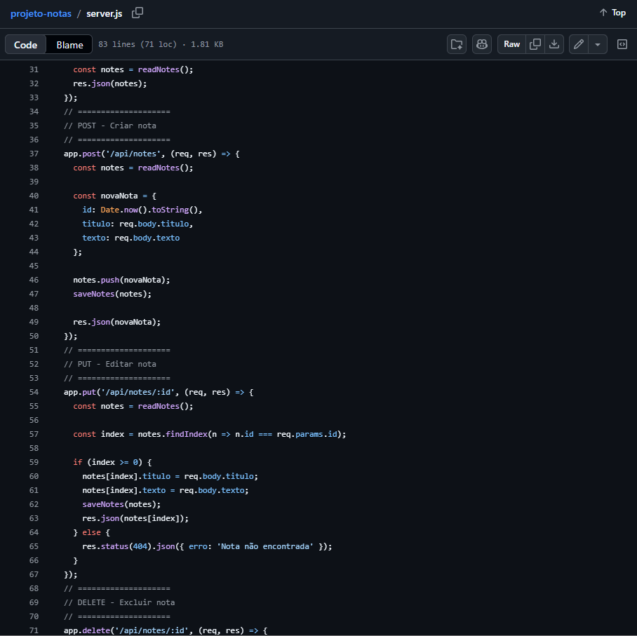
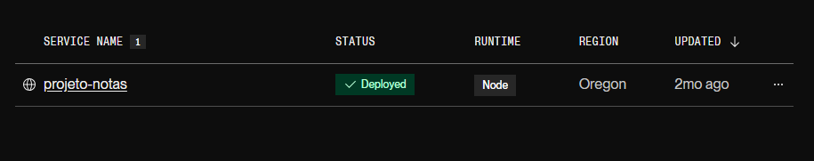
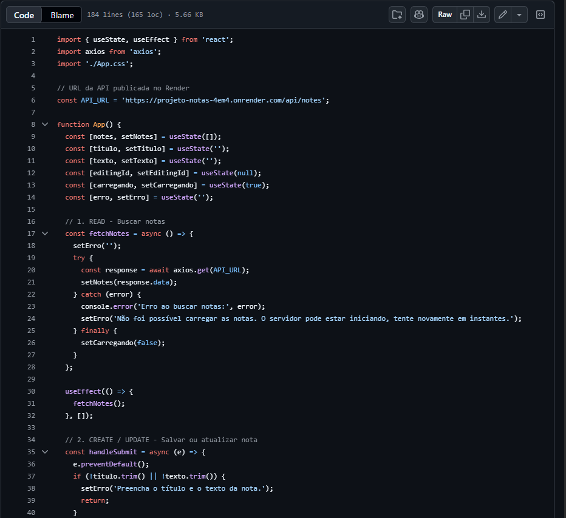
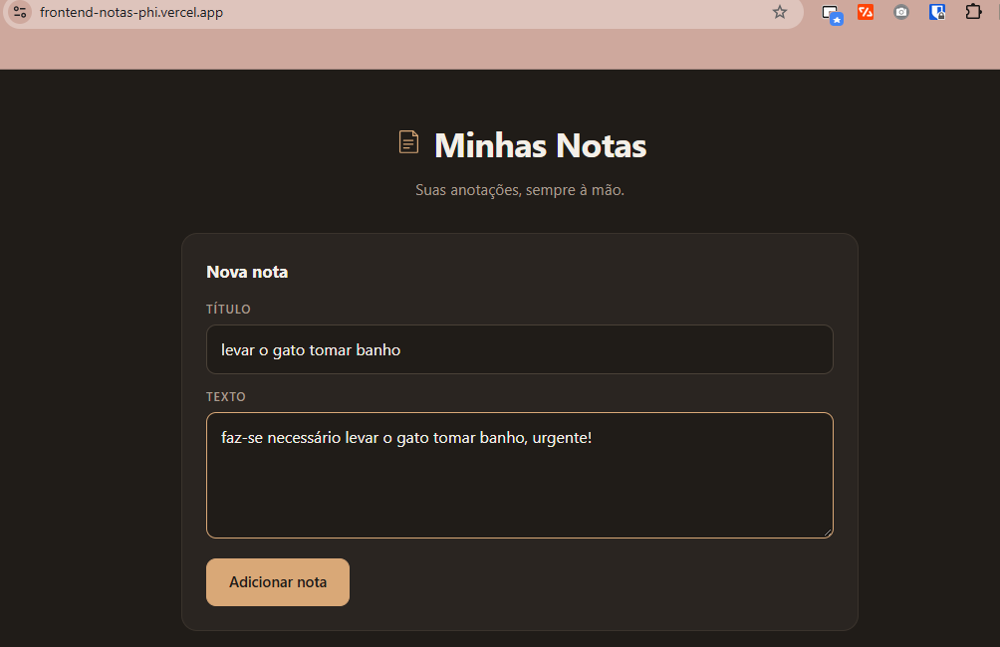
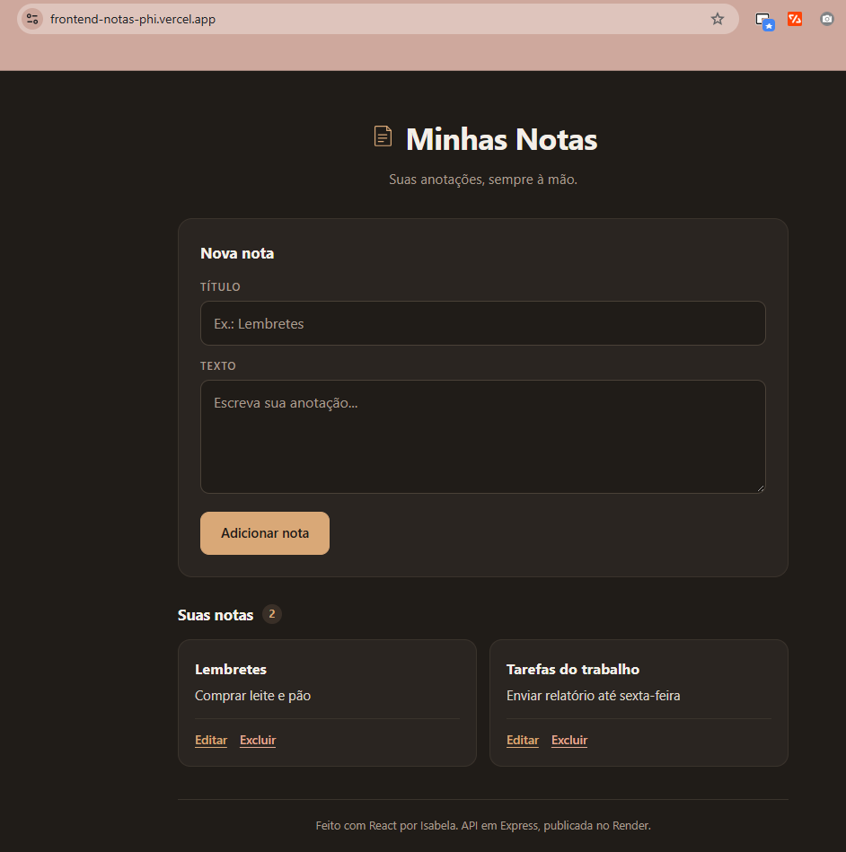
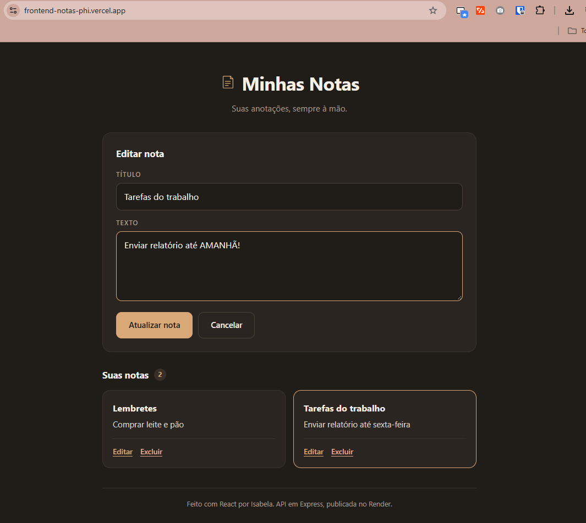
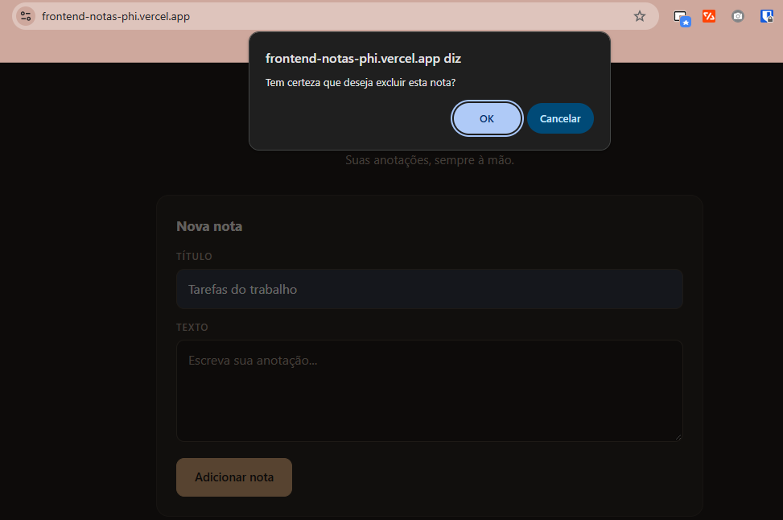
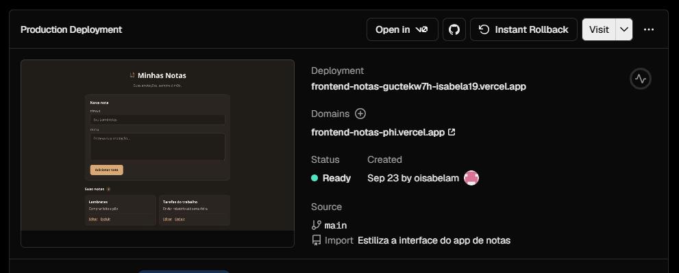
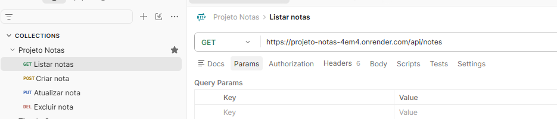
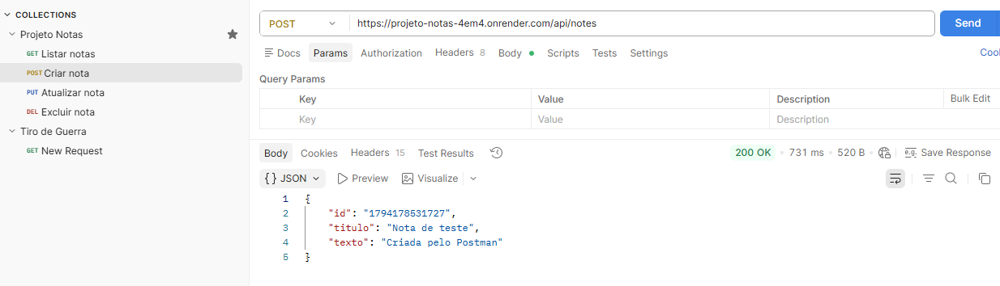

# Atividade 08 — CRUD de Notas com Express, React e Postman

**Disciplina:** Programação Web — Prof. Me. Deivison S. Takatu
**Integrantes:** [preencher]

## Links

| Item | Link |
|---|---|
| Repositório da API | https://github.com/oIsabelaM/projeto-notas |
| Repositório do front-end | https://github.com/oIsabelaM/frontend-notas |
| API no Render | https://projeto-notas-4em4.onrender.com/api/notes |
| Front-end na Vercel | https://frontend-notas-phi.vercel.app/ |
| Coleção do Postman | [projeto-notas.postman_collection.json](projeto-notas.postman_collection.json) |

## 1. API com Express

A API do relógio evoluiu para um CRUD de notas. As notas ficam salvas no arquivo `data.json`, e cada nota tem `id`, `titulo` e `texto`.

| Método | Rota | Ação | Respostas |
|---|---|---|---|
| GET | `/api/notes` | Lista as notas | 200 |
| POST | `/api/notes` | Cria uma nota | 200 |
| PUT | `/api/notes/:id` | Edita uma nota | 200 ou 404 (nota não encontrada) |
| DELETE | `/api/notes/:id` | Exclui uma nota | 200 |

## 2. Deploy no Render

1. **New → Web Service** e conexão com o repositório `projeto-notas`.
2. Build Command: `npm install`
3. Start Command: `node server.js`
4. Plano gratuito e clique em **Deploy**.

## 3. Front-end em React

Projeto criado com Vite e publicado na Vercel. Usa o **axios** para chamar a API e faz as quatro operações:

| Operação | Na tela | Requisição |
|---|---|---|
| Criar | Formulário com título e texto | `axios.post` |
| Visualizar | Lista de notas ao abrir a página | `axios.get` |
| Editar | Botão "Editar" carrega a nota no formulário | `axios.put` |
| Excluir | Botão "Excluir" em cada nota | `axios.delete` |

## 4. Documentação no Postman

A coleção **Projeto Notas — API CRUD** tem as quatro requisições, cada uma com descrição, corpo de exemplo e códigos de resposta. O arquivo está nesta pasta e pode ser aberto no Postman em **Import**.

## 5. Questões para refletir

**1. Quais são os riscos de segurança e como reduzi-los?**
A API aceita qualquer requisição de qualquer site, sem login e sem conferir os dados recebidos. Qualquer pessoa pode apagar ou alterar todas as notas, ou enviar textos enormes. Para reduzir: exigir autenticação (por exemplo, com JWT), validar o título e o texto, limitar o tamanho do corpo e o número de requisições, e liberar o CORS só para o domínio do front-end.

**2. Usar um arquivo JSON é uma boa prática em produção?**
Não. A vantagem é a simplicidade: não precisa de banco nem de configuração. As desvantagens são maiores: duas gravações ao mesmo tempo podem se sobrescrever, não há buscas nem índices, e no Render o disco é temporário, então as notas se perdem a cada novo deploy ou reinício. Em produção, o ideal é um banco de dados, como PostgreSQL ou MongoDB.

**3. O que aconteceria com 10.000 notas?**
Cada requisição lê e grava o arquivo inteiro. Com 10.000 notas, as respostas ficariam lentas, o uso de memória aumentaria e o risco de corromper o arquivo seria maior. Também não daria para paginar ou filtrar as notas sem carregar tudo.

**4. Por que é problemático ter tudo no `server.js`?**
Rotas, regras e acesso aos dados ficam misturados, o que dificulta entender, testar e manter o código. A melhoria seria separar em camadas, no padrão MVC: `routes/` para as rotas, `controllers/` para as regras e `models/` para o acesso aos dados.
